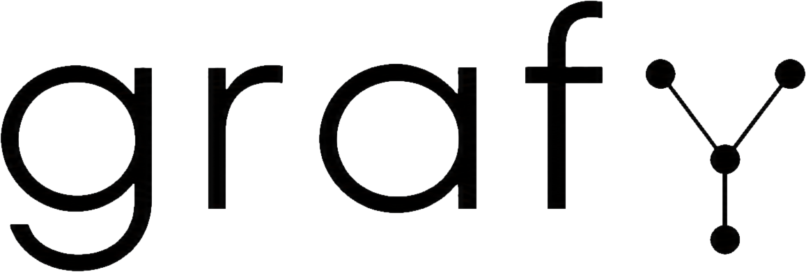
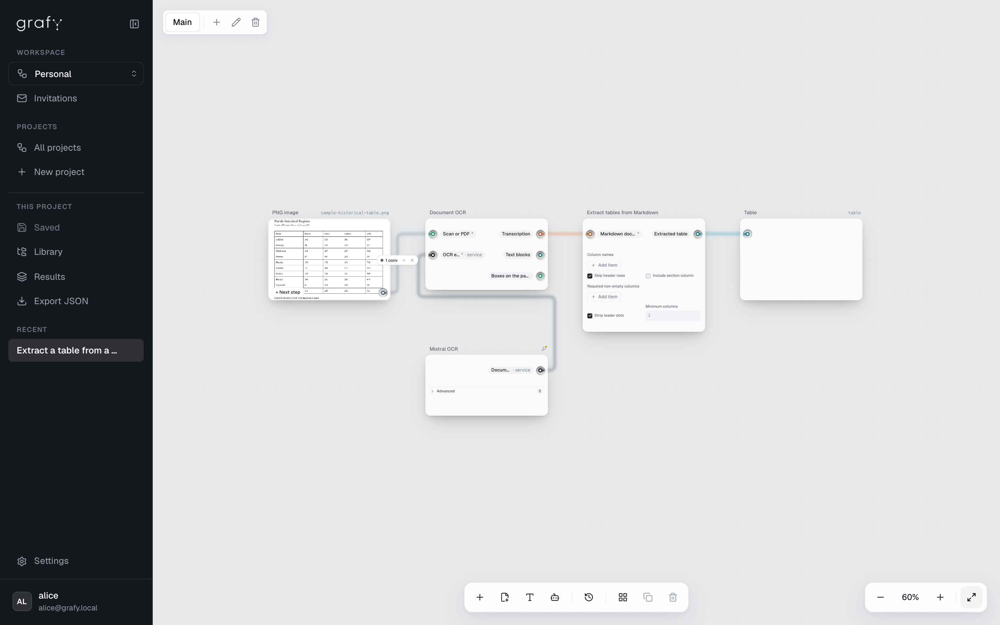

<div align="center">

<picture>
  <source media="(prefers-color-scheme: dark)" srcset="docs/assets/grafy-logo-dark.png" />
  <source media="(prefers-color-scheme: light)" srcset="docs/assets/grafy-logo-light.png" />
  
</picture>

### A node-first workbench for building and running typed artifact graphs

[Quick start](#quick-start) · [Architecture](#architecture) · [Node families](#node-families) · [GIS & Maps](#compose-vector-and-raster-maps) · [LLMs](#try-openai-compatible-generation) · [Verify](#verify) · [Containers](#containers)

<br />

<picture>
  <source media="(prefers-color-scheme: dark)" srcset="docs/assets/workbench-ocr-dark.png" />
  <source media="(prefers-color-scheme: light)" srcset="docs/assets/workbench-ocr-light.png" />
  
</picture>

*An OCR-to-table pipeline in grafY: an uploaded parish register scan (`file.png@1`) automatically converts on the edge (`1 conv`) into a raster, feeds **Document OCR** paired with a **Mistral OCR** service provider, extracts structured rows from Markdown, and renders the resulting **Table** artifact.*

</div>

---

## Overview

**Grafy** is a node-first workbench for building, inspecting, and running typed artifact graphs. Nodes declare typed ports, while edges may select schema-derived or explicit fields from compound artifacts or apply an ordered path of declared, versioned artifact conversions before a downstream node executes.

- **Explicit collection transport (`direct` vs `map`).** Every edge declares how values move. `direct` passes a compatible value with its collection shape unchanged; `map` connects a sequence to one item input, invokes the target once per item, broadcasts its other inputs, and returns ordered output sequences. Mapping is explicit graph structure rather than hidden node state.
- **Zero-boilerplate edge compatibility.** Field projection and artifact conversion are distinct compatibility primitives. Nested JSON Schema `string` and `integer` leaves are exposed as canonical scalar artifact types, and declared conversions (for example `file.png@1 -> image.raster@1` or chained `X -> Y -> Z` paths) persist and execute directly on one edge without cluttering the canvas with adapter nodes. Configurable or domain-significant transformations remain visible nodes.
- **Fingerprint-cached Runs & inline artifact viewers.** Node outputs are content-addressed and stored append-only in the Workspace result store. Only the stale upstream closure re-executes on a Run, and artifacts render directly on the canvas as interactive images, Markdown, structured tables, or tiled GeoTIFF and vector maps.
- **Collaborative Projects, Agents & MCP.** Workspaces scope Projects, multi-Graph compositions, shared Libraries, Tool packs, write-only encrypted provider credentials, canvas Agents with node tool links, and programmatic authoring through the [Grafy MCP server](docs/how-to-use-mcp.md).

<div align="center">
<picture>
  <source media="(prefers-color-scheme: dark)" srcset="docs/assets/workbench-table-dark.png" />
  <source media="(prefers-color-scheme: light)" srcset="docs/assets/workbench-table-light.png" />
  
</picture>

*A live-executed graph turning an authored Markdown artifact into a typed, paginated **Table** artifact (`6 rows / 4 columns`) with inline column controls and JSON export.*
</div>

---

## Quick start

For full native development setup, local OIDC / dev login, and script PAT minting, see [Run Grafy locally](docs/how-to-run-local.md).

```bash
just install
just dev
```

- **Workbench UI:** <http://localhost:3000>
- **Workbench API:** <http://localhost:8000> (health check at `/health`)
- **Internal TIFF tiler:** <http://localhost:8100>

The workbench defaults to local artifact storage and a local API URL. Set `GRAFY_STORAGE_BACKEND=s3` plus the S3 settings in `.env.example` for AWS S3 or an S3-compatible store such as MinIO.


### Development

`just api-dev` reloads on edits under `apps`, `libs`, and `plugins`, so a family edit is live on the next request. Nodes always run in the API process with no sandbox, no egress broker, and no release pin, and the catalog is the set of operators this build registered.
