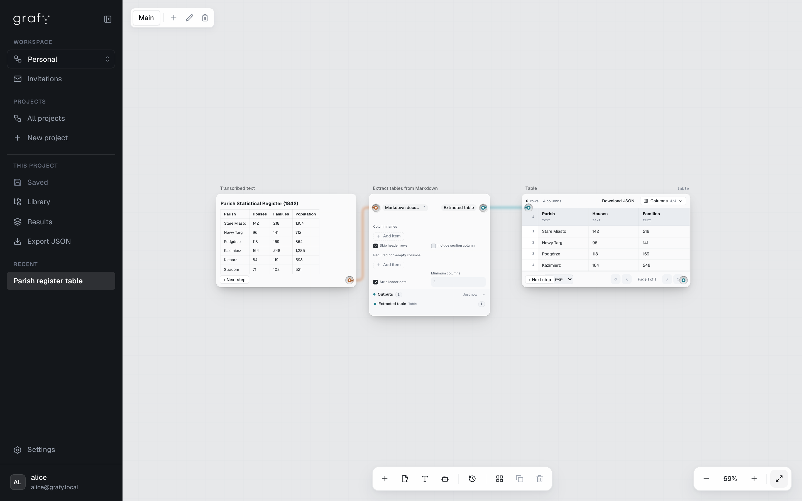
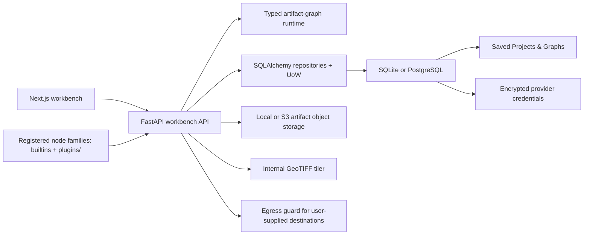
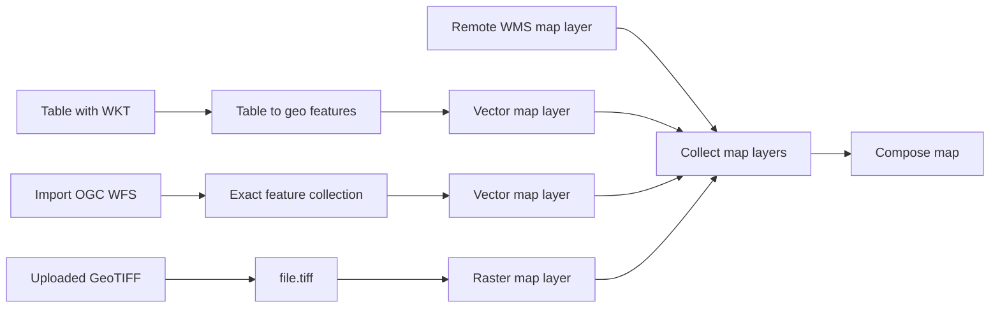
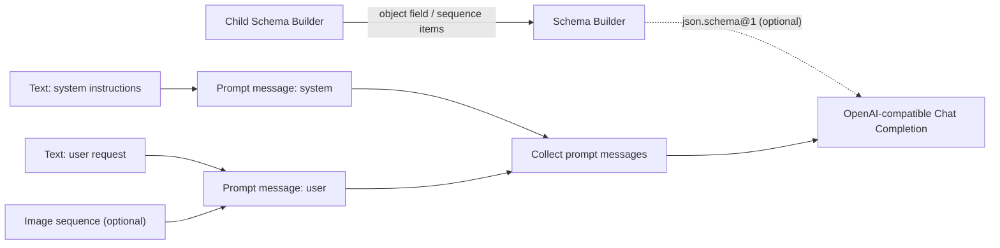

<div align="center">

<picture>
  <source media="(prefers-color-scheme: dark)" srcset="docs/assets/grafy-logo-dark.png" />
  <source media="(prefers-color-scheme: light)" srcset="docs/assets/grafy-logo-light.png" />
  
</picture>

### A node-first workbench for building and running typed artifact graphs

[Quick start](#quick-start) · [Architecture](#architecture) · [Node families](#node-families) · [GIS & Maps](#compose-vector-and-raster-maps) · [LLMs](#try-openai-compatible-generation) · [Verify](#verify) · [Containers](#containers)

<br />

<picture>
  <source media="(prefers-color-scheme: dark)" srcset="docs/assets/workbench-ocr-dark.png" />
  <source media="(prefers-color-scheme: light)" srcset="docs/assets/workbench-ocr-light.png" />
  
</picture>

*An OCR-to-table pipeline in grafY: an uploaded parish register scan (`file.png@1`) automatically converts on the edge (`1 conv`) into a raster, feeds **Document OCR** paired with a **Mistral OCR** service provider, extracts structured rows from Markdown, and renders the resulting **Table** artifact.*

</div>

---

## Overview

**Grafy** is a node-first workbench for building, inspecting, and running typed artifact graphs. Nodes declare typed ports, while edges may select schema-derived or explicit fields from compound artifacts or apply an ordered path of declared, versioned artifact conversions before a downstream node executes.

- **Explicit collection transport (`direct` vs `map`).** Every edge declares how values move. `direct` passes a compatible value with its collection shape unchanged; `map` connects a sequence to one item input, invokes the target once per item, broadcasts its other inputs, and returns ordered output sequences. Mapping is explicit graph structure rather than hidden node state.
- **Zero-boilerplate edge compatibility.** Field projection and artifact conversion are distinct compatibility primitives. Nested JSON Schema `string` and `integer` leaves are exposed as canonical scalar artifact types, and declared conversions (for example `file.png@1 -> image.raster@1` or chained `X -> Y -> Z` paths) persist and execute directly on one edge without cluttering the canvas with adapter nodes. Configurable or domain-significant transformations remain visible nodes.
- **Fingerprint-cached Runs & inline artifact viewers.** Node outputs are content-addressed and stored append-only in the Workspace result store. Only the stale upstream closure re-executes on a Run, and artifacts render directly on the canvas as interactive images, Markdown, structured tables, or tiled GeoTIFF and vector maps.
- **Collaborative Projects, Agents & MCP.** Workspaces scope Projects, multi-Graph compositions, shared Libraries, Tool packs, write-only encrypted provider credentials, canvas Agents with node tool links, and programmatic authoring through the [Grafy MCP server](docs/how-to-use-mcp.md).

<div align="center">
<picture>
  <source media="(prefers-color-scheme: dark)" srcset="docs/assets/workbench-table-dark.png" />
  <source media="(prefers-color-scheme: light)" srcset="docs/assets/workbench-table-light.png" />
  
</picture>

*A live-executed graph turning an authored Markdown artifact into a typed, paginated **Table** artifact (`6 rows · 4 columns`) with inline column controls and JSON export.*
</div>

---

## Quick start

For full native development setup, local OIDC / dev login, and script PAT minting, see [Run Grafy locally](docs/how-to-run-local.md).

```bash
just install
just dev
```

- **Workbench UI:** <http://localhost:3000>
- **Workbench API:** <http://localhost:8000> (health check at `/health`)
- **Internal TIFF tiler:** <http://localhost:8100>

The workbench defaults to local artifact storage and a local API URL. Set `GRAFY_STORAGE_BACKEND=s3` plus the S3 settings in `.env.example` for AWS S3 or an S3-compatible store such as MinIO.

---

## Architecture



| Package | Responsibility |
| --- | --- |
| `apps/web` | Infinite studio canvas, node & artifact viewers, schema-driven controls, edge projection/conversion/mapping editor, Library & Agent panels. |
| `apps/api` | Execution composition, collaboration rooms, and HTTP adapters under `/v1`. |
| `apps/tiler` | Standalone Python 3.13 internal TIFF tile and native window renderer (GDAL/rasterio) for GIS rasters and high-resolution archival scans. |
| `libs/core` | Artifacts, nodes, ports, service contracts, projections, conversions, runtime execution, Project/Graph aggregates, and Plugin contracts. |
| `libs/workbench` | App-built-in node families: `Image`, `Sequence`, `Value`, `Text`, `Schema`, `Table`, `File`, and `OCR`. Runs in-process with the API. |
| `libs/persistence` | Async SQLAlchemy repositories and unit-of-work adapters (SQLite & PostgreSQL). Alembic is the only schema authority. |
| `libs/storage` | Local filesystem and S3-compatible object storage adapters. |
| `libs/client` | Programmatic Python client and FastMCP server for authoring and running Graphs over the REST API. |
| `libs/crypto` & `libs/shared` | Shared credential/token cryptography and leaf configuration package. |
| `plugins/*` | Application-code node families: `gis`, `image`, `table`, `llm`, `mistral`, `reducto`, `litellm_ocr`, and `map_toponyms`. |

See [CONTEXT.md](CONTEXT.md) for the authoritative product vocabulary and active scope, and [docs/adr/](docs/adr/) for architecture decision records.

There is intentionally no legacy extraction pipeline, Dagster deployment, message broker, worker service, or platform API in this workspace.

---

## Node families

Each Plugin package under `plugins/` exports one `grafy_core.plugins.Plugin` declaration, and [`apps/api/src/grafy_api/services/families.py`](apps/api/src/grafy_api/services/families.py) decides which of them this build registers ([ADR 0017](docs/adr/0017-plugins-are-application-code-in-process.md)). A registered family is application code: it executes in the API process, identifies by family slug plus the deployment build digest, and has no release, revision, installation, or selection. A package that the composition does not list serves nothing, so adding a dependency alone does not activate a family.

Registered Plugin families in this build:

- **`plugins/gis`** — Exact WGS84 vector sources, OGC WFS/WMS integration, lightweight map-layer recipes, and ordered map composition rendered via MapLibre and the internal tiler.
- **`plugins/image`** & **`plugins/table`** — Extended image and tabular operations building on the producer-neutral `image.raster@1` and `table.data@1` contracts.
- **`plugins/llm`** — Provider-backed OpenAI-compatible Chat Completions (wrapping the official OpenAI Python SDK) and deterministic prompt-message construction.
- **`plugins/mistral`**, **`plugins/reducto`**, **`plugins/litellm_ocr`** — Document OCR providers implementing the `ocr.document@1` service contract consumed by the builtin **Document OCR** node, keeping API keys in encrypted credential storage.
- **`plugins/map_toponyms`** — Historical map text-box detection, baseline span preparation, crop recognition, and place-name extraction over multi-page TIFF sheets.

### Develop against local families

`just api-dev` reloads on edits under `apps`, `libs`, and `plugins`, so a family edit is live on the next request. Nodes always run in the API process with no sandbox, no egress broker, and no release pin, and the catalog is the set of operators this build registered.

---

## Workflows

### Compose vector and raster maps

The GIS workflow separates exact data from rendering instructions:



`geo.feature_collection@1` is the exact WGS84 vector source, and its stored JSON chunks are the only copy of its geometry. A georeferenced `file.tiff@1` is a map raster: the tiler renders each requested XYZ tile on demand from the stored file without downloading complete source artifacts into the browser. `geo.map_layer@1` references one source and owns its style, visibility, opacity, attribution, and zoom range. `geo.map_document@1` contains only an ordered list of layer references, a basemap choice, and optional initial bounds.

For tabular WKT, configure **Table to geo features** with the geometry column and its source CRS; the node reprojects supported point, line, polygon, multi-geometry, and geometry-collection values to exact EPSG:4326 features. Create a **Vector map layer** for each vector source and a **Raster map layer** for each GeoTIFF, collect the `geo.map_layer@1` outputs in drawing order, and connect the ordered sequence to **Compose map**. The preview loads on click and exposes local order, visibility, opacity, zoom, vector style, label, and raster image controls.

External GeoServer-compatible services follow the same model. **Import OGC WFS features** takes a bounded snapshot into an exact feature artifact, while **Remote WMS map layer** keeps the remote raster live and proxies only requested image tiles. For Atlas Fontium, use `https://data.atlasfontium.pl/geoserver/ows` (for example `geonode:powiaty` or `geonode:miejscowosci`). Service URLs must be public and credential-free, and WMS layers require explicit bounds and attribution. See [Run and verify a GIS raster import](docs/how-to-run-gis.md) for local GDAL and tiler setup.

### Try OpenAI-compatible generation

Build one provider-neutral prompt graph, then connect it to the generic external LLM node:



Add the system message to **Collect** before the user message. Keep the Collect-to-LLM edge in `direct` mode so the LLM receives the ordered conversation once (`map` would invoke it independently for every message). Configure the node's base URL, model, generation limits, and write-only API key after saving the Project. The default endpoint is OpenAI, while the same node can target an OpenAI-compatible LiteLLM or OpenRouter base URL. Remote endpoints must use HTTPS; plain HTTP is accepted only for localhost and loopback development.

Connect **Schema Builder** when structured output is needed. It emits Draft 2020-12 JSON text with an object root: add primitive fields inline, or choose Schema / Sequence of Schema to expose a field-owned input plug for another builder. The request uses Chat Completions `json_schema` response format and Grafy validates the returned object locally:

```json
{
  "type": "object",
  "required": ["title"],
  "properties": {
    "title": { "type": "string" }
  },
  "additionalProperties": false
}
```

The OpenAI-compatible adapter accepts PNG, JPEG, GIF, and WebP image artifacts on user messages (bounded to 8 images, 20 MB per image, and 50 MB aggregate before base64 encoding).

#### Write-only encrypted credentials

Provider nodes and the OpenAI-compatible node use write-only credentials encrypted at rest—never stored in Graph documents, run requests, artifact payloads, or read APIs. Generate one stable encryption key for the Grafy server and set `GRAFY_CREDENTIAL_ENCRYPTION_KEY` in `.env`:

```bash
openssl rand -base64 32
```

Keep that value stable and backed up: replacing or losing it makes existing encrypted credentials unusable. Workspace members with execution authority may run a node using a bound credential without retrieving it; creating, rotating, or removing shared credentials requires the separate `manage_secrets` capability. Expose Grafy through HTTPS so browser sessions and bearer credentials are never sent over an unprotected network.

---

## Verify

### Install and run commit hooks

`just install` installs the repository dependencies and enables the local commit hook. To enable the hook on its own, run `uv run prek install`.

Git then runs the staged-file checks from `.pre-commit-config.yaml` before each commit. To run checks manually on staged files, use `uv run prek run`. To validate the configuration and run every hook on all tracked files, use `just hooks-check`.

The hooks cover Python Ruff lint, web ESLint and Prettier, and fast repository hygiene checks. Tests, type checks, generated API contracts, and builds remain in CI and `just check`:

```bash
just check
```

`just check` runs backend tests, Python and TypeScript lint/type checks, verifies that the generated OpenAPI client is current, and builds the production web bundle.

`apps/tiler` is its own uv project on Python 3.13, so it is verified separately via `just test-tiler`, `just lint-tiler`, and `just typecheck-tiler` (which run in `apps/tiler/.venv`).

To exercise the runtime without the browser:

```bash
just smoke
```

---

## Containers

The API image installs `grafy-api` with the application families this build registers—the `grafy_workbench` builtins and the `plugins/` packages—plus the GDAL tools the GIS family shells out to. Every family executes inside the API process. A one-shot migration service completes before the API starts, and SQLite, uploads, and artifact objects share the durable `grafy-data` volume.

```bash
just docker-up
just docker-down
```

For production deployment with PostgreSQL, MinIO/S3, and the internal tiler, see [Deploy Grafy to production](docs/how-to-deploy-production.md).
