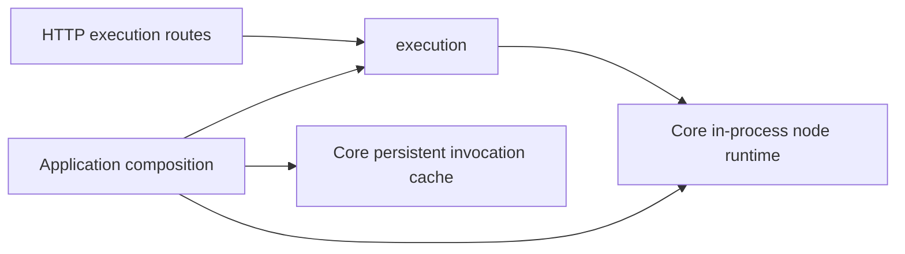
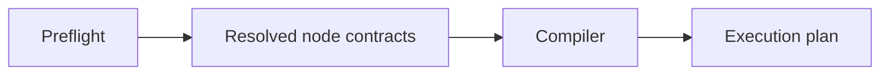
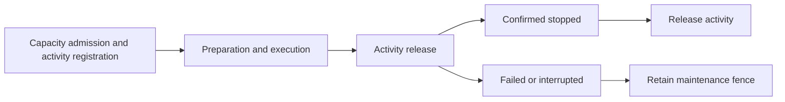

# Execution ownership

This package owns graph execution inside the API application. HTTP endpoints,
response models, and `RunResultPresenter` stay in `v1/routes/executions`.

| Module | Responsibility |
| --- | --- |
| `requests.py` | Durable run requests, graph-to-request conversion, and request validation. |
| `events.py` | Execution status and progress event contracts. |
| `models.py` | Compiled plans, prepared executions, and execution results. |
| `preflight.py` | Check submitted inputs and saved context before compilation. |
| `compiler.py` | Resolve nodes, contracts, and graph edges into a plan. |
| `run_graph.py` | Coordinate preparation, nested runs, and node scheduling. |
| `coordinator.py`, `node_execution.py`, `edge_values.py` | Schedule nodes, execute them, and resolve edge values. |
| `manager.py`, `admission.py`, `control.py` | Own run lifecycle, capacity, queue dispatch, events, and cancellation. |
| `history.py` | Persist saved-graph history and transient activity, and recover queued work. |
| `materializations.py` | Validate and retain graph-output materializations. |
| `errors.py` | Preserve execution failure context across nested runs. |

Node families are invoked in-process through `grafy_core.runtime.execution`. The
portable persistent invocation-cache adapter lives in
`grafy_core.runtime.persistent_invocation_cache`, beside its core cache contract.
Application composition wires these owners together.

Queued recovery stores request JSON. Moving a model must preserve field names,
validation, and serialized values. This package owns the request and event
classes and every consumer, HTTP presentation included, imports them from here.

Remaining dependencies are explicit. Edge projection reads through the core artifact
unit-of-work port. Materialization uses the application-owned `ArtifactAvailability`;
HTTP presentation still uses the artifact route reader.
Module lookup uses `ModuleLibraryService` directly, and the manager still
publishes through the collaboration hub. Their ownership and shared
transport-model cleanup remain separate audit items.

## Verify a package move

Run execution, API/client, and architecture tests. Compare OpenAPI with the
pre-change schema and exercise queued recovery, cancellation, and materialization.
Build both API and core wheels from clean generated build directories and inspect
their contents. Setuptools can retain deleted modules in an old `build/` directory;
a successful build alone does not prove that retired paths are absent.

## Node preparation

Preflight resolves each node's contract, config, and secret bindings once and returns a
read-only, Workspace-keyed map to compilation. Compilation can also resolve contracts
directly when used without preflight. Each run owns its map; nested runs and later
submissions prepare their own.

There is no admission decision to read at execution time: an operator is either
registered in this build or the request is rejected.

Saved-graph and nested-module workflows select their own active nodes and edges.
`RunNodeRequest.from_saved_node` and `RunEdgeRequest.from_saved_edge` own their
shared conversions, including connected plugs, artifact bindings, projections,
conversion paths, and collection modes. A node carries no Plugin identity: a
stored or submitted node with `kind: "plugin"`, a `plugin_release_pin`, or a
`plugin_release` is rejected.

## Artifact availability lifetime

Materialization and presentation load a fresh `ArtifactAvailabilityBatch` per
operation. Rows are read together, and repeated artifacts share a presence check.
Presentation uses those rows for summaries. Keep batches local to the operation;
a later request or preparation phase must reload and recheck storage. Availability
uses the core format-specific manifest/chunk checks and does not replace invocation
cache content-integrity validation.

## Inline execution ownership

Both background and synchronous HTTP runs enter `RunExecutionManager`. `start`
owns background tasks and their capacity leases. `run_inline` runs in the HTTP
caller's task and owns durable activity registration and removal; the HTTP route
retains its capacity lease through response presentation. Inline execution preserves
exceptions and cancellation instead of converting them into pollable state.

Do not inject `RunGraph` directly into an execution route. That bypasses the durable
activity used by System revocation and cutover. Module operators execute within
their parent's scope. Marker removal retries after persistence errors; a failed
removal retains activity for guarded startup recovery.

## Cleanup confirmation

Saved runs register an activity marker after claiming their queued history row and
before preparation. The existing `transient_executions` table tracks in-process
activity for saved and unsaved runs; it does not replace saved history.

Releasing the activity marker is retried, and a marker that cannot be released is
retained and reported rather than the run pretending it finished. An interrupted history
row does not override an activity marker. Normal execution errors and cancellation
release activity.

