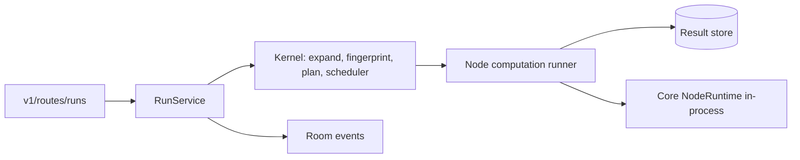

# Runs ownership

This package owns Runs inside the API application (ADR 0020). HTTP endpoints and
their models stay in `v1/routes/runs`; room fan-out stays in `realtime/run_events.py`.
It replaces the former `grafy_api.execution` package, whose manager, activity markers,
cutover fences, saved-graph history, materializations and Module execution are gone.

| Module | Responsibility |
| --- | --- |
| `service.py` | `RunService`: start, cancel, list, instance state, restart recovery. One kernel scheduler per `(Workspace, Project)`. |
| `facts.py` | `FingerprintFacts` for one document: implementation digests, cache policy, secret revisions. |
| `state.py` | `InstanceStateTracker`: last published instance states, diffed into room deltas. |
| `node_runner.py` | The kernel `ComputationRunner`: executes one node instance from stored upstream results. |
| `node_execution.py`, `edge_values.py`, `contract.py` | ONCE/MAP semantics, edge projection and conversion, node contract resolution. |
| `persistence.py` | `PersistentResultStore` (Workspace-bound `ResultStore`) and the repository-backed document source. |
| `ports.py`, `errors.py` | Seams the service depends on and its errors. |

## How a Run goes

1. `start` reads the live head document, expands the root Graph (call nodes inlined),
   fingerprints every instance, and plans only the stale part of the targets' upstream
   closure. A target set that is already fresh finishes the Run immediately.
2. The Run row is persisted as `running`, the plan is submitted to the Project's
   scheduler, and the room hears `run.started`.
3. Computations are single-flight per fingerprint across the Project's Runs. The
   runner reads upstream outputs from the store by fingerprint; the scheduler appends
   the result under the fingerprint the computation started with and moves the
   instance pointers. An edit during a Run therefore leaves the instance stale rather
   than corrupting it.
4. Cancelling a Run withdraws its demand; a computation is cancelled only when no
   other active Run still needs it.
5. When the Run's computations are terminal the Run row is finished and the room
   hears `run.finished`. Instance-state deltas are published after every scheduler
   transition and after every accepted command batch, serialized and coalesced per
   Project.

## Decisions that bind this package

- Fingerprints exclude node ids, the instance key and layout; identical content with
  identical upstream computes once.
- Secret revisions resolve by `(project, graph, node)` secret state, never by call path,
  and are opaque digests, never the secret.
- An operator the build does not register rejects the Run (`unknown_operator`). Nothing
  defaults to the `NEVER` cache policy. Boundary nodes (`graph.input`, `graph.output`)
  are pass-through and `EXACT`.
- In-flight state lives in the single API owner. On startup every `running` Run, in
  every Workspace, is marked `interrupted`; stored results stay fresh, so a rerun
  resumes from the fresh frontier.
- The result store has no garbage collection yet. That is required before production
  use and is tracked separately.

## Verify a change here

Run `tests/unit/runs`, `tests/unit/kernel` and `tests/unit/architecture`. Concurrency
tests wait on `asyncio.Event`, never on sleeps. Persistence behaviour needs
`GRAFY_TEST_POSTGRES_URL` for the relational path.
