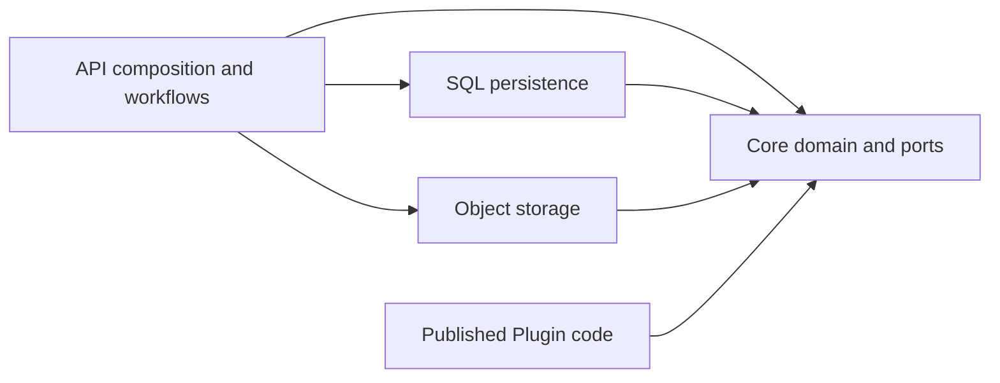
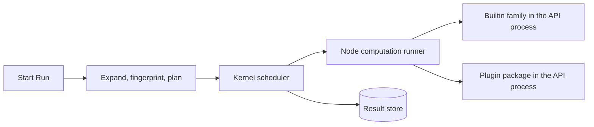

# Backend architecture reference

This reference describes current source ownership. Product vocabulary lives in
[CONTEXT.md](../../CONTEXT.md), and architectural decisions live in
[docs/adr](../adr/). In particular, [ADR 0007](../adr/0007-builtin-families-are-application-code.md)
supersedes the historical host-eligible Plugin execution model.

## Packages and dependency direction

| Owner | Responsibility |
| --- | --- |
| `apps/api/src/grafy_api` | HTTP and room transport, application composition, Runs, and the catalog of operators this build registers. |
| `libs/core/src/grafy_core` | Domain models, application workflows, ports, node runtime, artifact contracts, portable cache and storage readers. |
| `libs/persistence/src/grafy_persistence` | SQL repositories, transaction adapters, table metadata, database setup, and baseline persistence operations. |
| `libs/storage/src/grafy_storage` | Local and S3 object-store adapters. |
| `libs/workbench/src/grafy_workbench` | Application-owned builtin families: image, sequence, value, text, schema, table, and file. |
| `plugins/{gis,image,llm,mistral,sql,table,typesafe}` | Node families with their own packages and provider dependencies, installed into the API process and registered by `apps/api/src/grafy_api/services/families.py`. |
| `libs/client/src/grafy_client` | Python HTTP client contracts and operations. |

Core defines ports; persistence and storage implement them. Core does not import
those concrete adapters, API, FastAPI, SQLAlchemy, or published Plugin packages.
API composition constructs the adapters. Published Plugins do not import each
other or host application implementations.

These arrows denote imports, not the order of runtime calls. A core workflow can
call a port implemented by persistence without importing persistence.

## Composition and lifecycle

`grafy_api.main.create_app` registers transport and configures lifespan. Lifespan
loads `BuiltinNodeCatalog` using the deployment build digest, selects storage
through `grafy_api.storage.configured_file_storage`, constructs domain services,
and optionally starts the Docker Plugin runtime.

`services/composition.py` builds `WorkbenchComponents`, including compilation,
execution, artifact reads, catalog, and runtime dependencies. `AppResources`
retains that bundle rather than copying its fields. `AppIdentity` owns the
identity and authentication services. Request dependencies retrieve these typed
resources; domain services receive their dependencies directly.

Shutdown closes the Project room hub, Run service, optional Plugin runtime,
and artifact HTTP client in that order. The API's owner lease and database
lifecycle remain in `main.py`. In-memory room coordination requires the configured
single API owner; multiple workers are not an interchangeable deployment mode.

## HTTP, authentication, and collaboration

`v1/routes/<feature>/views.py` owns request handling and HTTP error translation.
Route-local models describe transport. Route files need not contain application
services merely to satisfy a directory pattern.

Authentication's cookie, OIDC, PAT, and abuse-handling code remains under
`v1/routes/auth`. Workspace transport models belong to `v1/routes/workspaces`. Core
identity policy and transaction-local workspace authorization live in
`grafy_core.application.identity`.
Graph workflows authorize through that shared policy, including ordered checks
for cross-workspace copies.

Core `ProjectService` owns Project metadata, folders, organization and per-user state.
Core `CollaborationService` owns Project creation, head command batches, checkpoints,
restore, copy and delete; `application/project_creation.py` stages the Project, its
first checkpoint and head. A Project belongs to exactly one Workspace.

`grafy_api.realtime` owns the Project room hub, post-commit publishing and Run/instance-state fan-out. The publisher
receives its dependencies instead of finding request resources. HTTP/WebSocket
adapters remain under collaboration routes.

`project_contracts.py` owns Project transport. `ProjectHeadResponse` is the one head shape: collaboration metadata (room epoch, collaboration sequence, checkpoint sequence and checkpoint revision) paired with the canonical `ProjectDocument`. The head, command and checkpoint responses and the room frames in `grafy_api.realtime.protocol` all carry it, so no client normalisation step sits between the server and the canvas. Shared layout and edge-conversion rules live beside the canonical models.

## MCP

There are no MCP packages in this repository; they were removed before the Projects
rework. A future MCP surface would use the same Project command batches as the web.

## Node families and the catalog

Every operator in this build is application code loaded in-process (ADR 0017). A family
is either a builtin under `libs/workbench` or a package under `plugins/`; both are
installed into the API environment and registered into one static
`grafy_core.plugins.PluginRegistry`, and a node identifies by family slug plus the
deployment build digest. There is no release pin, no installation, no selection and no
revocation to consult: a family that is not in `services/families.py` has no nodes, no
artifact types and no catalog entry.

The publication and isolated-hosting modules that used to sit under
`apps/api/src/grafy_api/plugins`, the guest protocol under `grafy_core.runtime`, and the
standalone egress broker are removed. Nothing reads a retired shape: a stored
document is parsed at its own schema version only, and a node whose stored `kind` is
neither `builtin` nor `call` fails validation instead of being rewritten.

`grafy_api.catalog.CatalogSnapshot` owns catalog assembly from the installed family
declarations. An entry is what this build registered,
so it carries no release identity and no readiness decision: a family that was
not installed has no entry at all. The upload extension table is built from the
same artifact declarations and refuses two owners for one extension.
`PluginRegistry` retains immutable family declarations and lookup indexes.
Canonical artifact conversions remain deployment-owned in core.

## Runs

`grafy_api.runs` owns Run planning, scheduling and node computation; HTTP endpoints
and models stay under `v1/routes/runs`. See the
[Runs ownership reference](../../apps/api/src/grafy_api/runs/README.md) and
[ADR 0020](../adr/0020-projects-hold-graphs-and-results-belong-to-nodes.md).

Results belong to node instances, addressed by fingerprint. The kernel in
`grafy_core.kernel` expands a Graph (call nodes inlined), fingerprints every instance,
plans the stale part of a Run's upstream closure and schedules computations with one
concurrency budget per Project, single-flight per fingerprint. The node computation
runner reads upstream results from the result store and runs one node in-process through
core `NodeRuntime`. Any number of Runs are active in a Project; cancelling one withdraws
its demand only. In-flight state lives in the single API owner, and startup marks
unfinished Runs interrupted while stored results stay fresh.

Edge projection reads artifact rows through the core artifact unit-of-work port, then
preserves exact-reference checks, projection, conversion order and provenance.

## Artifact contracts, reads, and infrastructure

`grafy_api.artifact_availability` resolves exact references and batches storage
presence checks for application workflows. Each operation loads fresh state.
Availability is weaker than cache content-integrity validation; do not substitute
one for the other. HTTP summaries, content responses, GIS tile/render handling,
and the WMS client remain in the artifact transport service.

Core owns producer-neutral stored contracts, including spatial payloads, styles,
map references, and feature metadata. GIS public aliases reuse those contracts.
API models retain explicit compatibility differences where required response
fields or historical reader acceptance differ from producer validation. GDAL,
provider calls, and raw raster upload inputs remain in GIS.

Core `spatial_storage` shares feature-page reconstruction and canonical byte/hash
validation. `stored_models` shares typed stored-model reads. Format-specific table
and collection readers retain their own manifest/chunk semantics.

`grafy_api.node_secrets` and `staged_uploads` own their application workflows.
Storage adapters only implement object IO. Sensitive capabilities and secret
resolution must remain explicit at those workflow boundaries.

## Persistence and deployment

`grafy_persistence.adapters.repositories` and `grafy_persistence.schema` are
packages grouped into identity, projects, runs and results, artifacts, uploads, and library.
`schema/base.py` owns shared metadata; the schema package loads the tables, and
`orm.py` maps them. `column_types.py` owns shared Pydantic/enum SQL conversion.
Alembic revisions under `infra/db/migrations` govern deployed schema changes. The
history is one baseline revision for the current schema and its downgrade drops
that schema.

Transaction adapters open task-local sessions and expose the repositories required
by each port. Writes commit explicitly. Context exit rolls back on error and
closes the session; it does not implicitly commit success. Core in-memory runtime
adapters preserve task isolation, cloning, and rollback for supported local use.

Docker definitions under `infra/docker` compose the gateway, API, web, and optional
PostgreSQL, Keycloak, and Plugin runtime services. Local and S3 object stores are
alternative adapters. Plugin egress has its own executable and Docker definition;
it does not require importing the API application.

## Enforcement and verification

`tests/unit/architecture/test_import_boundaries.py` enforces package dependency
rules and compatibility export identity. Execution and Plugin runtime scans
resolve absolute and relative Python imports, forbid HTTP route/framework imports
and historical host loaders, and keep Plugin hosting independent of graph
execution. Shared application owner checks cover realtime, graph contracts,
artifact availability, node secrets, and staged uploads. Static checks do not
claim to sandbox arbitrary dynamic imports.

Behavior lives in `tests/unit/api`, `tests/unit/core`, `tests/unit/client`, and the
feature suites under `tests/integration`. Frontend tests are colocated with their
TypeScript consumers. Schema comparison, generated client consistency, and
extracted-wheel checks protect contracts that directory checks cannot prove.

## Agents

Agents are Graph document values alongside nodes and presentation. Their add,
configure and remove commands use the same validated Project command batches as
other canvas edits. Agent setup survives checkpoints and Project copies; keys
are excluded from the document contract. Expansion and fingerprints read nodes,
edges and origins and ignore Agents. ADR 0021 defines the conversation runtime
and room protocol to be implemented above this document boundary.
