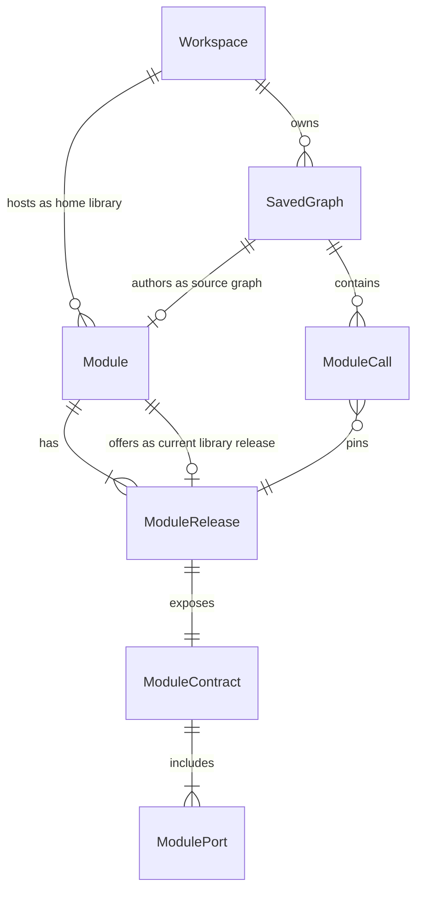
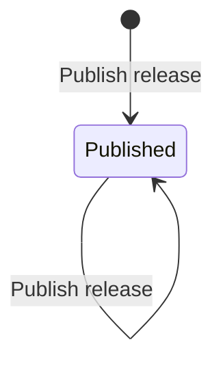
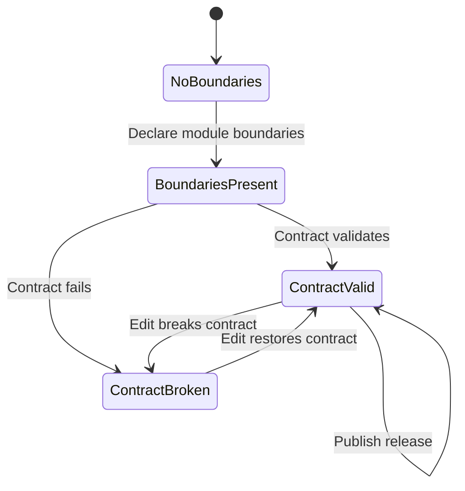

# Modules conceptual model

- **Status:** Draft hypothesis; belief-based (domain map without user research)
- **Date:** 2026-08-11, amended when Templates and the Module lifecycle were
  withdrawn ([ADR 0016](../adr/0016-graph-reuse-is-copies-and-modules.md))
- **Audience:** Designers and engineers changing module publish, library scope,
  catalog browse, or nested module execution
- **Document type:** Explanation — Layers of Product Design conceptual model
- **Related:** [modules domain map](modules-domain.md),
  [modules interaction structure](modules-interaction-flow.md),
  [modules surface](modules-surface.md),
  [authentication and workspace tenancy](authentication-and-workspace-tenancy.md),
  [product vocabulary](../../CONTEXT.md)

## Summary

This note decides how Grafy models **callable graph reuse**: a Module is a
validated workflow building block that other graphs call through an immutable
pinned release. It resolves the domain harvest into objects, relationships,
states, and ubiquitous language. It is not a database schema, wireframe, or
browse-UI spec.

Copying a whole graph is the other form of graph reuse and is not this model's
subject: that is **Duplicate** on a saved graph, described in
[graph browser organization](graph-browser-organization.md). An earlier draft
of this note also modelled **Templates** as a second reuse aggregate beside
Modules; that aggregate is withdrawn (see
[ADR 0016](../adr/0016-graph-reuse-is-copies-and-modules.md)) because copying a
graph already covered it and its library entry point competed with Modules for
the same word.

**Hypothesis flag:** Built from the belief-based [domain map](modules-domain.md).
Revisit once observed behaviour or research challenges these decisions.

### Core job

Publish a validated workflow building block that other graphs can call through
an immutable pinned release, while preserving the Workspace tenancy boundary and
never creating live cross-tenant references.

### Material

- [Modules domain map](modules-domain.md)
- Existing product: a module is any in-workspace saved-graph revision that
  validates with Module Input/Output boundaries; tip revisions are
  catalog-visible automatically; discovery is workspace-scoped
- Tenancy: Workspace is the only share boundary; graph copy clears
  cross-workspace module references

### Implicit model being replaced

Today, “having valid boundaries” silently means “appears in the node catalog.”
This model replaces that with an explicit **Module** that enters a workspace
**library** only when someone **publishes a release**.

## Object definitions

### Workspace

**What it is:** The sole collaboration and tenancy boundary; it also hosts that
workspace’s module library.

**Attributes users care about:** name/slug, kind (`personal` or `shared`).

**Relationships:**

- hosts zero or many Modules (as home library)
- owns zero or many Saved graphs

**Actions:** (existing membership and graph actions; no new library aggregate)

**Decision:** “Personal toolkit” and “team library” are roles of a Workspace,
not separate objects. A personal workspace library is private to its owner; a
shared workspace library is visible to members according to existing
capabilities. Product surfaces translate those backend locations into **My
graphs** and named **Team** save/share locations. There is no instance-public
or org-wide library in this model.

---

### Saved graph

**What it is:** The durable authoring document (workflow graph + canvas layout).

**Attributes users care about:** name, revision (tip), whether it declares
module boundaries.

**Relationships:**

- belongs to one Workspace
- may be the source graph of zero or one Module
- contains zero or many Module calls

**Actions:** Edit, Checkpoint, Declare module boundaries (add Module Input /
Module Output), Open, Duplicate (copy into a chosen Workspace, existing
share-by-copy).

**Decision:** A Saved graph with boundaries is only a *candidate* until a Module
is published from it. Boundaries alone do not list it in the library.

---

### Module

**What it is:** A reusable workflow building block belonging to one workspace
library, authored from one source graph.

**Attributes users care about:** name, description, and its releases. A Module
has no lifecycle state to manage: publishing a release is the only transition,
and a published Module stays in the library.

**Relationships:**

- belongs to one Workspace (as home library)
- authored from one Saved graph (as source graph)
- has one or many Module releases
- offers zero or one current library release (the release shown for Insert)

**Actions:**

- **Publish release** — create a Module release from a chosen source-graph
  revision (usually the tip) after the contract validates; first publish
  creates the Module, and every later publish adds another release
- **Open source graph** — open the authoring Saved graph

**Decision:** Module is a first-class object, not “a graph that happens to
validate.” Name and description are module-facing; they may start from the
source graph name but are not required to track tip renames automatically
(implementation may; UX must not surprise callers mid-compose).

There is no **Deprecate**, **Withdraw**, un-publish, or hard delete. Removing a
release from under a pin would break pinned calls; hiding it buys a signal that
nobody was reading, because nothing in the system moves a pin on its own. The
way to retire a Module is to stop publishing from it and let its pins age out,
or delete its source graph's Workspace.

---

### Module release

**What it is:** An immutable, callable version of a Module with a fixed
contract, pinned to one source-graph revision.

**Attributes users care about:** release number (the pinned graph revision),
when it was published (if shown), whether it is the current library release.

**Relationships:**

- belongs to one Module
- pins exactly one Saved graph revision of the source graph
- exposes exactly one Module contract

**Actions:** Inspect contract; choose as target when **Upgrading** a Module
call. Users do not edit a release in place — they publish a new release.

**Decision:** Call sites always pin a Module release. “Track latest” is not a
stored mode in this model; staying current means **Upgrade module call**.

---

### Module contract

**What it is:** The callable surface of one Module release: named input and
output module ports with artifact types and requiredness.

**Attributes users care about:** port name, direction (input/output), artifact
type, requiredness, optional description.

**Relationships:**

- belongs to exactly one Module release
- composed of one or many module ports (at least one output)

**Actions:** Inspect (no independent edit — change the source graph and
publish a new release).

**Decision:** Contract is user-meaningful (composers depend on it) so it is
named as an object, even if storage derives it from boundary nodes at publish
time. Port **name** replaces product language “public name” to avoid
visibility polysemy. Boundary operators remain the authoring mechanism.

---

### Module call

**What it is:** A node in a Saved graph that invokes one Module release.

**Attributes users care about:** which Module, which pinned release, wiring to
module ports.

**Relationships:**

- belongs to one Saved graph (as containing graph)
- pins exactly one Module release
- must not target the Module whose source graph is the containing graph
  (no self-call while editing that module’s source)

**Actions:** Insert module call, Upgrade module call, Open source graph (when
the Module’s home workspace is the active workspace), Remove.

---

### Set aside (not objects in this model)

| Noun from harvest | Treatment |
| --- | --- |
| project | Rejected as product term → Workspace + Saved graph |
| library / personal toolkit / shared library | Role of Workspace, not a separate aggregate |
| catalog | Insert/browse *surface* (interaction layer), not an object |
| subgraph | Authoring structure inside a Saved graph, not a durable object |
| building block | Synonym → Module |
| draft | State of source work / unpublished candidate, not an object |
| fork | Outcome of Duplicate, not a persistent type |
| template | Withdrawn aggregate → Saved graph + Duplicate ([ADR 0016](../adr/0016-graph-reuse-is-copies-and-modules.md)) |
| dependency | Relationship via Module call → Module release |
| practitioner | User (existing) |

## Object map

Cardinality: `||` exactly one, `o|` zero or one, `|{` one or many, `o{` zero
or many. Labels read left entity → right entity as declared.

## State transitions

### Module publication state

| State | Library browse / Insert | Existing Module calls |
| --- | --- | --- |
| Published | Listed; current library release offered | Resolve pinned releases |

A Module does not exist until the first successful **Publish release**. A Saved
graph may declare boundaries and still have no Module.

Two further states, `deprecated` and `withdrawn`, remain readable from storage
and are unreachable: they are the states of Modules published before this
decision. They keep those rows loadable and keep their pinned calls resolving.
They are absent from library browse and Add node, and no surface can move a
Module into or out of them
([ADR 0016](../adr/0016-graph-reuse-is-copies-and-modules.md)).

### Source graph readiness (authoring, not Module state)

**Publish release** is enabled only from `ContractValid` on the chosen
revision. Broken tips never become library releases; prior releases stay
callable.

### Temporal decisions

| Topic | Decision |
| --- | --- |
| History | Module releases are immutable; callers keep pins |
| Relationship temporality | “Current library release” means the release offered for new inserts *now*; existing calls do not move |
| Deletion | No delete of a Module or a release. Existing Module calls keep resolving pinned releases; do not destroy releases out from under pins |
| Cross-workspace | Duplicate the source graph into the destination Workspace; it becomes a Module there when someone publishes it. No live cross-workspace Module reference and no copy that keeps Module identity |
| Read model lag | UX requirement: after Publish, the active workspace library reflects the change before the user inserts again — how fresh is an open engineering question |

## Ubiquitous language

### Nouns

| Term | Rejected alternatives | Decision |
| --- | --- | --- |
| Module | building block, component, package, template | Product name for the reusable callable unit |
| Module release | tip-as-catalog-entry, version (alone), checkpoint | Immutable callable pin; number aligns with source graph revision |
| Module contract | API, signature, interface | Callable ports of one release |
| Module port / port name | public name, public port | Avoid “public” = visibility |
| Module call | nest, embed, reference (alone), invoke (UI) | Node that pins a Module release |
| Workspace library | catalog, registry, toolkit (as object) | Published modules hosted by a Workspace |
| Source graph | project, upstream module graph | The Saved graph a Module is authored from |
| Saved graph | project, pipeline, notebook | Keep existing CONTEXT.md term |
| Workspace | project (as tenant) | Keep existing tenancy term |
| Folder | nested folder, directory tree | Optional one-level organization inside a Workspace; not a tenancy boundary |

**Visibility language:** Prefer **published** and **personal vs shared
workspace**. Do not use **public/private module** for library scope — “private”
already collides with personal workspace and “public” collides with port names
and internet sharing.

### Verbs

| Verb | Applies to | Rejected alternatives | Decision |
| --- | --- | --- | --- |
| Publish release | Module (creates Module on first success) | Share, expose, make public, sync tip | Deliberate offer of a validated revision to the workspace library |
| Insert module call | Saved graph + Module release | Add node (when meaning module), nest, embed | Places a Module call pinned to a release |
| Upgrade module call | Module call | Update, sync, track latest | Repin to a newer Module release |
| Declare module boundaries | Saved graph | Make module (premature), expose ports | Authoring step; does not publish |
| Open source graph | Module or Module call | Edit module, drill in | Navigate to authoring document |

**Share** remains the existing workspace/graph meaning (membership or
copy-graph-into-workspace). It must not mean “publish module.”

**Edit** on a Module is rejected as a CTA — users **Open source graph**, edit
the Saved graph, then **Publish release**.

**Deprecate**, **Withdraw**, and **Import into workspace** are withdrawn verbs.
A Module that should not be used anymore is simply not published from anymore; a
Module wanted in another Workspace is **Duplicated** there.

## Resolved decisions (binding)

1. **No delete:** Owners do not destroy Modules or releases out from under pins,
   and there is no softer retirement to reach for instead. Existing Module calls
   remain executable as long as the underlying node/operator code can execute the
   pinned release.
2. **Who may Publish:** Editor + Owner (`publish_module`). There is no separate
   library-management capability; the library is the set of published Modules.
3. **Insert release choice:** Composers may pick an older Module release at
   insert time (not only the current library release). Upgrade still repins to a
   chosen release (typically a newer one).
4. **Library entry points:** Modules appear in **Add node / Library** and in the
   Workspace **Modules** library dialog. Inserting creates a pinned call node;
   copying a graph is **Duplicate** on the graph, not a library action.
5. **Cross-workspace:** Reuse a Module in another Workspace by Duplicating its
   source graph there. Nothing links the two afterwards.
6. **Retired states are read-only:** a stored `deprecated` or `withdrawn` Module
   loads, stays hidden, and keeps its pins resolving. No surface edits it.

## Remaining open questions

1. **Rename propagation:** When the source graph is renamed, does the Module
   name follow, stay independent, or prompt on next publish?
2. **Nested optional-input rules** and execution semantics stay as today’s
   runtime contracts; this model does not reopen them.
3. **Discovering a stale pin:** with no deprecate signal, the library cannot tell
   a composer that release 1 is a poor choice. Whether the surface should show
   "3 newer releases" is open.

## Next step

Interaction breadboards are in [modules-interaction-flow.md](modules-interaction-flow.md).
Next: `/layers-surface` or implementation against a stable model.

This model was built without domain research — it is a hypothesis. Plan to
revisit it once you have evidence.
