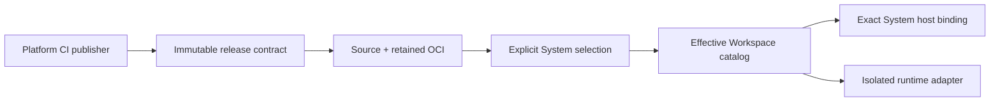

# Plugin unification (one System release model)

- **Status:** Implemented. One release module, one namespace, one publication
  authority.
- **Date:** 2026-08-24, retargeted for ADR 0015
- **Audience:** Engineers changing plugin discovery, catalog identity, CLI, or
  isolated execution
- **Document type:** Explanation — architecture and boundaries
- **Related:** [plugin development](plugin-development.md) (first-party System
  authoring), [ADR 0005](../adr/0005-separate-plugin-releases-from-installations.md)
  (releases vs installations), [ADR 0015](../adr/0015-plugins-are-system-only.md)
  (Plugins are System-only), [modules conceptual model](modules-conceptual-model.md),
  [backend architecture](backend-architecture.md),
  [product vocabulary](../../CONTEXT.md)

## Summary

A **Plugin** is a uv-managed project (`pyproject.toml`, `uv.lock`, typed nodes,
tests, artifact contracts, and runtime registrations). Execution trusts an
immutable release, never a mutable working tree. A project exports
`grafy_plugin.PLUGIN`; the checked-in inventory names the loader target each slug
may publish under. The Python import name is not catalog identity.

One release module serves one publication authority: a platform/CI publisher
holding a platform access token stages a release with explicit distribution and
execution policy, and a separate platform action promotes it. A release retains
exact source, contract, lock, protocol, profile, capability, and OCI identities.
Graphs pin the operator and `{scope, slug, revision}` independently, and `scope`
is always `system`.

The current exact System release may use a deployment-bound in-process fast path
only when loaded bytes match its baked host binding. Historical System releases
use retained OCI. Catalog, compiler, and the defensive Docker boundary share one
deployment-owned release admission; an exact revocation is always denied as
`revoked`. Host code is imported only from an exact deployment manifest; absent
configuration is Module-only.

A **Module** stays a published subgraph. It is not a Plugin.

## Shared release lifecycle

`grafy plugin publish <directory> --slug <slug> --sandbox-image <image>`
authenticates with a platform token whose scope is `plugin.publish_global`:

1. Requires the slug to appear in `plugins/system-plugins.toml` and the
   directory to be below a configured Plugin root and to contain its own
   `pyproject.toml`, `uv.lock`, source, and tests.
2. Resolves the directory canonically, rejects symlinks, special files,
   traversal, escaping paths, and oversized trees before snapshotting, and
   stages the accepted files into a private directory.
3. Builds a deterministic source archive from the staged bytes (stable
   ordering independent of filesystem enumeration) **before any Plugin code
   runs**, then unpacks that exact archive for verification. Tests and
   inspection therefore consume an unpacked copy of the frozen bytes, never
   the mutable working copy.
4. Runs `uv lock --check` and a locked sync against the frozen snapshot,
   rejecting `[tool.uv.sources]` path dependencies that resolve outside the
   snapshot; then runs the Plugin's locked tests and catalog inspection. These
   steps run in the Docker-isolated one-shot publisher; the online API never
   imports a working copy or receives publication authority.
5. Stores the digest-addressed source archive under the garbage-collectable
   `plugin-releases/` namespace, builds and stores the immutable OCI runtime
   artifact, and appends an append-only `plugin_releases` row whose descriptor
   references independent digests: source, inspected contract, runtime profile,
   invocation protocol, capabilities, lock, and runtime image.
   The source archive itself contains no generated release metadata, so image
   digests can never feed back into source digests. Publishing identical
   inputs is idempotent; changed inputs advance the Plugin release revision.

The immutable objects form a one-way chain: working copy → source archive +
source digest → inspected contract + contract digest → OCI image + image digest
→ release descriptor referencing those digests.

The contract digest covers declared contract bytes only. Every defaulted
contract field is classified `omit` or `keep` in
`PLUGIN_CONTRACT_DIGEST_FIELD_ROLES` in
`grafy_core.domain.plugin_releases`. An `omit` field is excluded from the digest
while it holds the empty value it was declared with, so a catalog parsed with those
fields added after the bytes were persisted digests the same as those bytes; a
`keep` field stays serialized at its default. The classification test fails
when a defaulted field is added without a role. Declared extension claims and
non-default confirmation rules stay in the digest. Releases published before
the empty defaults were dropped keep their own digest form, which
`plugin_contract_digest_matches` still accepts. That set is closed: exactly two
digests of one catalog verify, and a later canonicalization change migrates the
stored form instead of adding a third. A catalog therefore carries the digest of
the window it was published in. The guest image hashes with the
SDK wheel vendored in its own lock, so that wheel carries the same
canonicalization as the host.

Anything that changes `libs/core` changes that wheel, so rebuild it in the same
commit: `just sdk-wheel`, then `uv lock --upgrade-package grafy-core` inside
`tests/fixtures/plugin-notes`, then set the new digest in
`test_plugin_families_are_installed_from_the_workspace`. The order matters — the
fixture's lock records the wheel's digest, so locking before rebuilding leaves it
stale and publication fails with a hash mismatch. The architecture test fails when
you forget the digest.

6. Overlays the promoted releases in `GET /v1/workspaces/{id}/nodes`, including
   Plugin-owned artifact types and function-node contracts.

Catalog nodes carry an exact `{scope, slug, revision}` pin and derived
readiness. A release is
runnable only when its immutable image, invocation protocol, runtime profile,
capabilities, and complete artifact contract are supported by the deployment.
The selector disables unsupported or revoked releases with a stable reason;
deprecated and withdrawn families stay visible but cannot be newly inserted,
while their retained exact pins may continue to run. Insertion of a runnable
Plugin writes its exact release pin into the graph.
`tests/fixtures/plugin-notes` is the executable freeze, Table-bundle, and
offline fixture the publication tests run against.

Publication never means promotion, and current is an exact pointer rather than
the highest revision. Extension-claim collisions against an installed format or
another selected family are refused at promotion; the release stays retained, so
the operator fixes the claim and promotes again.



## What the seam is for

The hard question was never "how does someone write Python." It is **how a
directory becomes a revisioned catalog entry without loading it into FastAPI**.

Verification and promotion are that seam. Verification answers "what would this
freeze be?"; promotion answers "is it live?". Neither invents a revision ahead
of its bytes nor retargets graph pins. Graphs stay on exact Plugin release N
until someone explicitly selects retained release N+1.

## Working copy vs freeze

The **working copy** is the directory you open in your editor. It is not
authoritative for execution.

The **freeze** is the immutable artifact Grafy stores (source archive + locked
runtime image, keyed by digest). Graph runs trust the freeze.

A checkout from Grafy and a git clone of the same project are both working
copies. Publish always hashes exact bytes.

## Plugin roots (deploy config)

A deployment config allowlists **roots** — directories where Plugin working
copies may be read from. It is not the catalog.

```toml
plugin_roots = ["./plugins"]
```

Relative paths resolve from the process working directory (normally the
deployment or project root). A root prevents publish from pointing at `/` or a
secrets volume; it grants no visibility. Catalog membership comes from persisted
System selections, and identity authority comes from the inventory.

## Runtime profile

The runtime profile is deployment policy (`python-uv` today), never Plugin
source or author-selected metadata.

## Publish lifecycle

1. Confirm the tree is under an allowlisted Plugin root and that the inspected
   `grafy_plugin.PLUGIN` slug, loader target, and capabilities match the
   inventory entry for the publish target.
2. Snapshot the source, lock-check, locked sync, required tests, inspection —
   all against the frozen snapshot, never the working copy.
3. Freeze the source archive, build the deployment-owned runtime profile, and
   store both digest-addressed artifacts in the object bucket (S3 or local).
4. Insert append-only **revision N** (monotonic). Same digest as revision N
   → no new row.
5. Require `plugin.publish_global` on the platform credential before untrusted
   tests/builds and again at the release transaction.

After promotion, `GET /v1/workspaces/{id}/nodes` lists the Plugin's nodes
(`llm.openai_compatible.chat_completion@1`, …) from that release row, not from
the host registry. The compiler resolves those operator ids from the selected
release and executes the freeze offline.

`runnable` is derived from the complete release. The current runtime supports
canonical inline scalar JSON, release-owned inline JSON contracts, and the
portable `table.data@1` bundle. Missing images, old invocation protocols,
unsupported profiles/capabilities, and unknown artifact formats remain visible
but disabled with a stable reason.

## Typing, types, and dependencies

Nodes use the same `function_node` surface in every Plugin project: Pydantic models,
`InPort` / `OutPort`. Catalog **NodeSpec** is derived from those contracts in
the freeze, without importing the package into FastAPI.

Dependencies on Table or GIS are complete exact artifact contracts
(`table.data@1` plus schema, materialized shape, projections, exports, and
`table-bundle@1`), not `grafy-plugin-gis` in `pyproject.toml`. A key/version
alone cannot prove compatibility.

Python wheels live in the Plugin's `uv.lock` and are installed only at freeze.
Native tools (GDAL) are **named profiles**: ops-pinned image digests, never
`apt` in the sandbox, never a user Dockerfile. Graph run stays
`--network none`. `uv` talks only to the deployment's package index.

The versioned Grafy Plugin SDK (`grafy-core`) is supplied as a wheel, never a
monorepo-relative path dependency: each project vendors it under `wheels/` and
pins it through `[tool.uv.sources]`, and deployments that build their own SDK
wheel expose it to the publisher through `UV_FIND_LINKS`. Publication rejects
any path dependency resolving outside the frozen snapshot.

A Plugin may declare new artifact types. Release-owned canonical inline JSON
models can use the existing inline writer shape inside the isolated runtime.
A Pillow `Image` (or any host-unknown Python object) is not executable until a
portable bundle contract exists and the host explicitly supports it. Another
Plugin cannot consume a custom type by importing its owner; it must
independently support the same stable wire contract.

## Catalog overlays

| Entry | Visibility | Exact identity |
| --- | --- | --- |
| System Plugin release | Every Workspace | `{system, slug, revision}` |
| Module release | Owning Workspace library | `graph.module.{id}@{revision}` |

Unknown saved operators use generic inert compatibility rendering and remain
non-runnable until explicitly mapped to a verified release. A stored pin naming
the removed Workspace scope resolves to nothing and is reported as
`unsupported_plugin_release_scope`.

Cross-Workspace reuse stays copy-by-value for Modules (import into workspace).
Plugins were never Workspace-owned, so there is nothing to copy.

## Execution

Graph execution stays the API process's scheduler, but the release adapter is
chosen only after exact resolution and shared admission. A current,
host-eligible System release with an exact deployment binding may use the
loaded implementation. Every other admitted release follows: retained OCI →
one hardened `--network none` sandbox per `(top-level execution scope, exact
Plugin release)` → fresh `.venv/bin/python -I` child and invocation scratch per
scalar call → destroy at scope exit. No `uv`, image pull, or package
installation occurs at graph run.

## What not to do

- Generic Python package entry points for Plugins.
- Import a working copy into the API host registry.
- Auto-create revisions from filesystem watchers.
- Put teammate writer/resolver code on the API `sys.path`.
- Treat `docker-trusted-development` as a production isolation boundary.
  Profiles and verified publication do not replace a later hardened runtime.
- Reintroduce a per-Workspace catalog by widening `PluginReleaseScope`. A
  Workspace-scoped catalog needs a real owner, authority, and lifecycle, and
  ADR 0015 removed all three on purpose.

## Migration boundary

```text
transitional host package → staged System release + OCI → exact host binding
Plugin project            → verified freeze             → System release
saved graph               → verified baseline map       → exact System pins
```

Host packages are inert until an exact deployment manifest names their loader
target and installed-byte digest. A future authoring surface must call the
existing verification, promotion, and exact-pin boundaries rather than introduce
synthetic catalog nodes or a mutable execution path.
