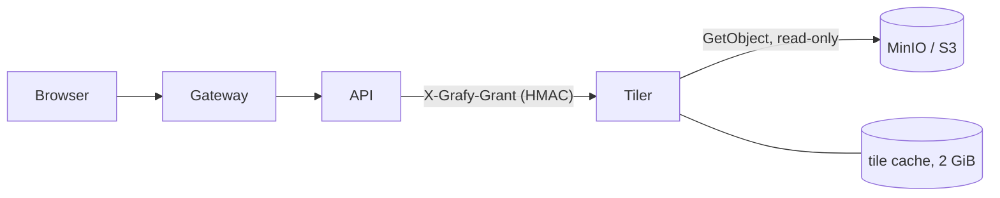

# TIFF on-demand tiles

`image/tiff` artifacts cannot render in the workbench: browsers do not decode
TIFF, so an `` on the raw bytes shows "Preview unavailable". Grafy renders
TIFFs on demand instead of converting them at import. A separate **tiler**
container produces deep-zoom tiles and thumbnails; the API stays the only public
entry and decides who may see what.

This document records the decisions behind the tiler (`apps/tiler`) and the
constraints the API proxy and the web viewer must keep. The tiler ships first and
is invisible until the API proxy lands.

## Shape

1. The browser calls `/workspaces/{ws}/artifacts/{id}/image/{info,tiles/{z}/{x}/{y}.{png|jpg},thumbnail}`
   on the API. These URLs are the contract; the backend behind them may change.
2. The API checks `VIEW_ARTIFACTS`, loads the artifact scoped to the Workspace,
   and refuses non-TIFFs.
3. A request whose `If-None-Match` equals the deterministic ETag is answered 304
   without calling the tiler. The ETag derives from sha256, page, z/x/y, format
   and the tiler's renderer version.
4. Otherwise the API signs a short-lived **grant** and proxies to the tiler over
   the internal network. It proxies and never redirects.
5. With `GRAFY_TILER_URL` unset the tile routes answer 501 and the web shows
   "Preview unavailable". The API does not `depends_on` the tiler.

## The tiler never takes a URL

Server-side request forgery is closed by construction. The tiler has no URL or
path parameter. Its only input is the `X-Grafy-Grant` header: base64url JSON
`{v, b: bucket, k: key, s: sha256, n: byte_size, p: page, exp}` plus an
HMAC-SHA256 signature.

- The key is `TILER_SIGNING_KEYS` (the API's `GRAFY_TILER_SHARED_KEY`): 32+
  characters, comma-separated so an operator can rotate without downtime.
- A grant expires after 60 s and is compared in constant time.
- The bucket must equal `TILER_BUCKET`; the key must be a relative object key
  with no `..`, no leading `/` and no NUL.
- The tiler builds `/vsis3/{bucket}/{key}` itself. The S3 endpoint is fixed by
  environment and uses path-style addressing, so GDAL cannot be pointed at
  another host.
- `n` is bounded by `TILER_MAX_SOURCE_BYTES`. In `local` mode the stored size
  must also equal `n` (409). In `s3` mode GDAL's `/vsis3/` offers no stat, so
  the SHA-256 in the grant, which is part of every cache key, is what ties
  cached output to the bytes.
- Credentials are a dedicated MinIO account allowed `s3:GetObject` on the one
  bucket, nothing else.
- `TILER_STORAGE=local` reads `<TILER_LOCAL_ROOT>/<bucket>/<key>` for native
  development against the local file store, with the resolved path required to
  stay inside the root. Deployments use `s3`.

The API signer and the tiler verifier are separate code in separate lock files.
A golden-vector file read by both test suites keeps the wire format in
agreement.

## Rendering

Tiles are deep-zoom **pixel-space**: level `max` is full resolution and level
`L` has scale `2^(L-max)`; tile `(x, y)` covers source window
`[x*T*2^(max-z), ...]`, edge tiles are cropped, out-of-range is 404. GeoTIFFs
render as pictures; georeferencing is reported in `info` and otherwise ignored.

`TODO(geo-open-on-map)`: opening a georeferenced TIFF on the map (Web Mercator
tiles) is a later feature. It will live next to `render.py`, behind a reserved
`/image/geo/...` path. The tiler already reports `georeferenced`, `crs` and
`bounds_wgs84` in `info` for it.

| Concern | Decision |
| --- | --- |
| Output format | `.jpg` for opaque images, `.png` when there is alpha, a mask or nodata. `info.tile_format` says which; the URL extension must match. |
| Resampling | `nearest` when the file has overviews (GDAL then reads the smallest sufficient overview), `average` when it has none. |
| 16-bit and float | Rescaled with one fixed range per file and page: the 2nd to 98th percentile, computed lazily from a small overview read on first view and cached. Every tile uses the same range, so there are no seams. |
| Striped TIFF without overviews | Every low-zoom tile would decode the whole image. If measured too slow, the first view builds a lazy overview of at most 2048 px into the cache. It is evictable and never an import-time conversion. pyvips is only a fallback if that is insufficient. |
| CMYK | Naive CMYK to RGB; no ICC in v1. |
| Multipage | Page `n` via `GTIFF_DIR`; `info` reports `page_count`. |
| Limits | Source at most 1 GiB, at most 2e9 pixels, at most 1024 pages. |
| GDAL trap | `GDAL_DISABLE_READDIR_ON_OPEN` must stay unset: with it, opening a later page of a multipage TIFF over `/vsis3/` hangs inside GDAL. |
| Read-only account | `s3:GetObject` alone is enough; GDAL's listing probes are denied and ignored. |

Stock TiTiler does not work for non-georeferenced images (`ImageReader.info()`
fails without a CRS), so the tiler is a thin FastAPI app on rio-tiler.
`titiler.core` is kept only for its error handlers and middleware. The tiler has
its own project and lock file in `apps/tiler`, outside the root uv workspace,
because `titiler.core` needs `starlette>=1` while the API pins `starlette<1`.

## Cache lives in the tiler

One volume (`grafy-tiler-cache`) holds rendered tiles, thumbnails, cached value
ranges and any lazy overviews. It is capped (`TILER_CACHE_MAX_BYTES`, default
2 GiB), evicted by least-recent access at insert time, and written with atomic
temp-and-rename. Nothing is ever invalidated: keys are digest-addressed, and
bumping the renderer version retires old tiles.

It is in the tiler, not the API or a reverse proxy, because the tiler owns the
render parameters and the version, the API stays stateless about rasters, disk is
bounded in one place, and `proxy_cache` or `X-Accel-Redirect` would not exist in
development and cannot see through a header grant. Browser immutable caching and
the API's 304 absorb warm traffic. `X-Accel-Redirect` is out of scope for v1.

## Resource bounds

All environment-configurable; the defaults suit the ai-ihpan host (2 CPUs,
1.5 GiB RAM, about 600 MB image, 2 GiB cache volume). `TILER_WORKERS` defaults to
1: a multi-worker run under concurrent load lost a worker during measurement, so
concurrency is a bounded render thread pool inside one process. The plugins'
`_MAX_CONCURRENT_PROCESSES` is untouched.

| Variable | Default |
| --- | --- |
| `TILER_WORKERS` | 1 |
| `TILER_RENDER_CONCURRENCY` | 2 |
| `TILER_QUEUE_DEPTH` | 32, then 503 |
| `TILER_RENDER_TIMEOUT_SECONDS` | 30 |
| `TILER_CACHE_MAX_BYTES` | 2 GiB |
| `TILER_GDAL_CACHE_MB` | 128 |

Error mapping the API relays: unreadable TIFF 422 (memoized 60 s), out-of-range
tile 404, overload or timeout 503 with `Retry-After`, tiler down 503, bad grant
502 (the API signed it, so a refusal is a deployment fault).

## Deployment

- Own Dockerfile `infra/docker/tiler.Dockerfile`, Python 3.13, base image pinned
  by digest, non-root, `uv sync --locked`. The API image is unchanged.
- Compose service `tiler`: `cpus`/`mem_limit` from environment (defaults 2 and
  1536m), `pids_limit`, read-only root with a tmpfs `/tmp`, `cap_drop: [ALL]`,
  `no-new-privileges`, no host port, health check on `/health`.
- Published as `ghcr.io/artpods56/grafy-tiler:<sha>` by the same gated
  `publish-images` job as the other images.
- The operator creates the read-only MinIO account and the shared key; see
  `docs/how-to-deploy-production.md`. No secret is committed anywhere.

## Reverse states

Disabling is unsetting `GRAFY_TILER_URL` (routes answer 501). A rollback to a
SHA without a tiler is handled by `--remove-orphans`. The cache is derived data,
safe to delete at any time.
