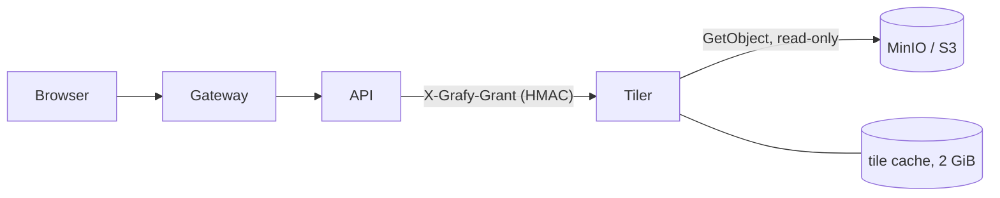

# TIFF on-demand tiles

`image/tiff` artifacts cannot render in the workbench: browsers do not decode
TIFF, so an `` on the raw bytes shows "Preview unavailable". Grafy renders
TIFFs on demand instead of converting them at import. A separate **tiler**
container produces deep-zoom tiles, thumbnails and native pixel windows. The
API stays the only public entry and decides who may see what.

This document records the decisions behind the tiler (`apps/tiler`) and the
constraints the API proxy and the web viewer must keep. The API exposes the
Workspace-scoped proxy; the canvas card that reads it is described under "The
card frames the page".

## Shape

1. The browser calls `/workspaces/{ws}/artifacts/{id}/image/{info,tiles/{z}/{x}/{y}.{png|jpg},thumbnail}`
   on the API. These URLs are the contract; the backend behind them may change.
2. The API checks `VIEW_ARTIFACTS`, loads the artifact scoped to the Workspace,
   and refuses non-TIFFs.
3. A request whose `If-None-Match` equals the deterministic ETag is answered 304
   without calling the tiler. The ETag derives from sha256, page, z/x/y, format
   and the tiler's renderer version.
4. Otherwise the API signs a short-lived **grant** and proxies to the tiler over
   the internal network. It proxies and never redirects.
5. `GRAFY_TILER_RENDERER_VERSION` must match the tiler renderer version, and
   must change when rendering configuration changes the output. It participates
   in ETags. The proxy rejects a mismatched renderer header on image responses.
6. With `GRAFY_TILER_URL` unset the tile routes answer 501 and the web shows
   "Preview unavailable". The API does not `depends_on` the tiler.

## The tiler never takes a URL

Server-side request forgery is closed by construction. The tiler has no URL or
path parameter. Its only source selector is the `X-Grafy-Grant` header: base64url JSON
`{v, b: bucket, k: key, s: sha256, n: byte_size, p: page, exp}` plus an
HMAC-SHA256 signature.

- The key is `TILER_SIGNING_KEYS` (the API's `GRAFY_TILER_SHARED_KEY`): 32+
  characters, comma-separated so an operator can rotate without downtime.
- A grant expires after 60 s and is compared in constant time.
- The bucket must equal `TILER_BUCKET`; the key must be a relative object key
  with no `..`, no leading `/` and no NUL.
- The tiler builds `/vsis3/{bucket}/{key}` itself. The S3 endpoint is fixed by
  environment and uses path-style addressing, so GDAL cannot be pointed at
  another host.
- `n` is bounded by `TILER_MAX_SOURCE_BYTES`. In `local` mode the stored size
  must also equal `n` (409). In `s3` mode GDAL's `/vsis3/` offers no stat, so
  reads rely on the stored object key remaining bound to the artifact. The
  SHA-256 in the grant ties cached display output to that identity.
- Credentials are a dedicated MinIO account allowed `s3:GetObject` on the one
  bucket, nothing else.
- `TILER_STORAGE=local` reads `<TILER_LOCAL_ROOT>/<bucket>/<key>` for native
  development against the local file store, with the resolved path required to
  stay inside the root. Deployments use `s3`.

The API signer and tiler verifier share `grafy_crypto.grants` from `libs/crypto`.
This dependency-free package supports both Python 3.13 and 3.14 while the services
keep separate lock files. It owns the wire format, signing and verification;
the API owns authorization and each service supplies its keys and limits.
Golden vectors in `libs/crypto/tests/golden` pin compatibility across deployments.
The protocol tests run in both Python environments.

## Rendering

Tiles are deep-zoom **pixel-space**: level `max` is full resolution and level
`L` has scale `2^(L-max)`; tile `(x, y)` covers source window
`[x*T*2^(max-z), ...]`, edge tiles are cropped, out-of-range is 404. GeoTIFFs
render as pictures; georeferencing is reported in `info` and otherwise ignored.

`TODO(geo-open-on-map)`: opening a georeferenced TIFF on the map (Web Mercator
tiles) is a later feature. It will live next to `render.py`, behind a reserved
`/image/geo/...` path. The tiler already reports `georeferenced`, `crs` and
`bounds_wgs84` in `info` for it.

| Concern | Decision |
| --- | --- |
| Output format | `.jpg` for opaque images, `.png` when there is alpha, a mask or nodata. `info.tile_format` says which; the URL extension must match. |
| Resampling | `nearest` when the file has overviews (GDAL then reads the smallest sufficient overview), `average` when it has none. |
| 16-bit and float | Rescaled with one fixed range per file and page: the 2nd to 98th percentile, computed lazily from a small overview read on first view and cached. Every tile uses the same range, so there are no seams. |
| Striped TIFF without overviews | Every low-zoom tile would decode the whole image. If measured too slow, the first view builds a lazy overview of at most 2048 px into the cache. It is evictable and never an import-time conversion. pyvips is only a fallback if that is insufficient. |
| CMYK | Naive CMYK to RGB; no ICC in v1. |
| Multipage | Page `n` via `GTIFF_DIR`; `info` reports `page_count`. |
| Limits | Source at most 1 GiB, at most 2e9 pixels, at most 1024 pages. |
| GDAL trap | `GDAL_DISABLE_READDIR_ON_OPEN` must stay unset: with it, opening a later page of a multipage TIFF over `/vsis3/` hangs inside GDAL. |
| Read-only account | `s3:GetObject` alone is enough; GDAL's listing probes are denied and ignored. |

Stock TiTiler does not work for non-georeferenced images (`ImageReader.info()`
fails without a CRS), so the tiler is a thin FastAPI app on rio-tiler.
`titiler.core` is kept only for its error handlers and middleware. The tiler has
its own project and lock file in `apps/tiler`, outside the root uv workspace,
because it targets Python 3.13 while the workspace targets Python 3.14.

### Raster mosaics

A `raster_mosaic` map layer stitches up to 64 georeferenced `file.tiff@1`
sources, listed bottom to top, without writing a merged
raster. The API keeps the stitching cheap before it reaches the tiler: it
pre-filters sources by their WGS84 footprint, answers 204 when none overlaps the
tile, sends a lone overlapping source to the ordinary `/geo/tiles` route, and
calls the mosaic route only when two or more overlap.

- `POST /geo/mosaic/tiles/{z}/{x}/{y}.{ext}` takes a signed `MosaicGrant` in a
  JSON body `{"grant": ...}`. Sixty-four sources do not fit the 16 KiB header
  limit of uvicorn/h11, so this is the one route whose grant is not the
  `X-Grafy-Grant` header. The payload adds `"kind": "mosaic"` and a `src` list
  of `{k, s, n, p}`; each source passes the same checks as a single grant.
  Single-source verification rejects any payload carrying `kind`, so neither
  token is accepted on the other's routes.
- `GeoMosaicComposer` composites from the top sheet down with premultiplied
  Porter-Duff `dst-over`: each lower sheet only fills the coverage left by the
  sheets above it. Anti-aliased edges blend without halos, grayscale and RGB
  sheets mix, and once the tile is opaque the remaining lower sheets are never
  opened or decoded.
- Composite tiles are cached as `geomosaic:{renderer}:{mosaic_digest}:{format}:{z}/{x}/{y}`.
  `mosaic_digest` hashes the ordered `(sha256, page)` list, so reordering the
  stack is a different tile and an object-key rename is not. Each source reuses
  its own cached info and lazy geo overview.

## The card frames the page

A canvas card is a window onto the page: growing the frame shows more scan, never
the same scan bigger. OpenSeadragon does the opposite on its own, because its
zoom is a magnification relative to the frame (`getBounds().width` is `1 / zoom`)
so holding it across a resize redraws the page proportionally wider. The surface
therefore watches its own size (`autoResize: false`) and divides the held zoom by
the width it gained, anchoring the view at its top-left — the corner opposite the
grip a card is dragged by. `minZoomImageRatio` (0.25) is the floor: OpenSeadragon
reads its minimum zoom as a fraction of home, so the page stops shrinking at a
quarter of the frame and grows with it past that.

The frame's shape belongs to the operator, not the page: a height they dragged is
the band of scan they asked for, and the page is cropped or margined by it. The
page's aspect, read from `info` because a TIFF has no `` to report a natural
size, only sets the box a card starts with; without it every scan would start in
the 4:3 fallback and a portrait page would sit in a landscape box.

## Native pixel windows

Server code calls `ArtifactImageService.read_window(access, artifact_id,
col=..., row=..., width=..., height=..., page=0)` with Workspace access
authorized for `VIEW_ARTIFACTS`, including the PAT scope check when applicable.
The service resolves the artifact's stored source in that Workspace. This
works for both ordinary TIFFs and parameterized GeoTIFF COG artifacts. A
window on a COG uses the pixel grid of the stored COG. A TIFF upload can be
read directly through its file artifact.

The internal tiler receives the signed source grant and integer
`col`, `row`, `width` and `height` query parameters on `GET /window`.
Offsets are zero-based from the top left of the granted page. The rectangle
is half-open and must fit entirely inside the raster. Crossing an edge gives
422. At most 1,000,000 pixels and 8 MiB of PNG may be returned per read.
The read uses the source grid at 1:1 and bypasses display rendering and caching.
It accepts 8-bit grayscale and RGB, including JPEG YCbCr decoded to RGB by GDAL.
PNG preserves those decoded sample values. An alpha
band retains its opacity where the source mask and nodata allow it. Palette,
CMYK, sub-byte, higher-depth, and layouts that require color-space conversion
return 415.
GDAL reads intersecting blocks or strips. A crop whose estimated block decode
exceeds `TILER_MAX_WINDOW_DECODE_BYTES` returns 413. The default is 64 MiB.

The response carries the PNG body and an `X-Grafy-Window` JSON header with
the actual `col`, `row`, `width`, `height`, `affine` and `crs`. With usable
georeferencing, `crs` carries WKT and the six affine coefficients
`[a, b, c, d, e, f]` map
crop-local pixel corners `(x, y)` to `(a*x + b*y + c, d*x + e*y + f)` in
the returned CRS. This includes rotation and shear. Without usable
georeferencing, both fields are null and the source offsets still locate the
crop on the TIFF.

The canvas window selector writes the detector's saved page and pixel bounds
through graph authoring. The selected rectangle and the previous run's
polygons both use full-page pixel coordinates, so changing the selection
leaves the previous detections anchored while the viewer serves display tiles
at the current zoom. Scan area selects either that rectangle or the entire
page. Automatic strategy pads reads around the scan area and splits large
areas into overlapping native windows within the read limit. It merges
detections in page pixels and includes polygons whose centers fall in the
scan area, keeping the full shape of labels that cross its border. Single crop
reads exactly the requested bounds and retains the native read limit.

The detector reports separate window counts for the first scan and any seam
repair pass. These are transient Project room events. The canvas can show
progress while a Run is active, and the result remains independently readable
after the progress history is gone.

Recognition consumes a saved set of detections. It reads each polygon from the
source page at native resolution, masks its surroundings, and straightens the
crop before sending it to the connected recognizer. The recognition artifact
keeps the source-page polygon and the recognizer's raw text, confidence, and
model revision together.

## Cache lives in the tiler

One volume (`grafy-tiler-cache`) holds rendered tiles, thumbnails, cached value
ranges and any lazy overviews. It is capped (`TILER_CACHE_MAX_BYTES`, default
2 GiB), evicted by least-recent access at insert time, and written with atomic
temp-and-rename. Nothing is ever invalidated: keys are digest-addressed, and
bumping the renderer version retires old tiles.

It is in the tiler, not the API or a reverse proxy, because the tiler owns the
render parameters and the version, the API stays stateless about rasters, disk is
bounded in one place, and `proxy_cache` or `X-Accel-Redirect` would not exist in
development and cannot see through a header grant. API responses use
`Cache-Control: private, max-age=300`: revocation may lag by up to five minutes
in a browser cache. Every network read rechecks Workspace access. Authorized matching
ETags return 304 without contacting the tiler. `X-Accel-Redirect` is out of scope for v1.

## Resource bounds

All environment-configurable; the defaults suit the ai-ihpan host (2 CPUs,
1.5 GiB RAM, about 600 MB image, 2 GiB cache volume). `TILER_WORKERS` defaults to
1: a multi-worker run under concurrent load lost a worker during measurement, so
concurrency is a bounded render thread pool inside one process. The plugins'
`_MAX_CONCURRENT_PROCESSES` is untouched.

| Variable | Default |
| --- | --- |
| `TILER_WORKERS` | 1 |
| `TILER_RENDER_CONCURRENCY` | 2 |
| `TILER_QUEUE_DEPTH` | 32, then 503 |
| `TILER_RENDER_TIMEOUT_SECONDS` | 30 |
| `TILER_CACHE_MAX_BYTES` | 2 GiB |
| `TILER_GDAL_CACHE_MB` | 128 |

Error mapping the API relays: unreadable TIFF 422 (memoized 60 s), out-of-range
tile 404, overload or timeout 503 with `Retry-After`, tiler down 503, bad grant
502 (the API signed it, so a refusal is a deployment fault).

## Deployment

- Own Dockerfile `infra/docker/tiler.Dockerfile`, Python 3.13, base image pinned
  by digest, non-root, `uv sync --locked`. The API image is unchanged.
- Compose service `tiler`: `cpus`/`mem_limit` from environment (defaults 2 and
  1536m), `pids_limit`, read-only root with a tmpfs `/tmp`, `cap_drop: [ALL]`,
  `no-new-privileges`, no host port, health check on `/health`.
- Published as `ghcr.io/artpods56/grafy-tiler:<sha>` by the same gated
  `publish-images` job as the other images.
- The operator creates the read-only MinIO account and the shared key; see
  `docs/how-to-deploy-production.md`. No secret is committed anywhere.

## Reverse states

Disabling is unsetting `GRAFY_TILER_URL` (routes answer 501). A rollback to a
SHA without a tiler is handled by `--remove-orphans`. The cache is derived data,
safe to delete at any time.
